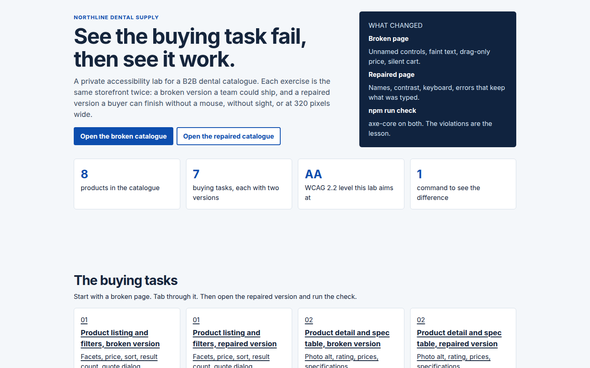
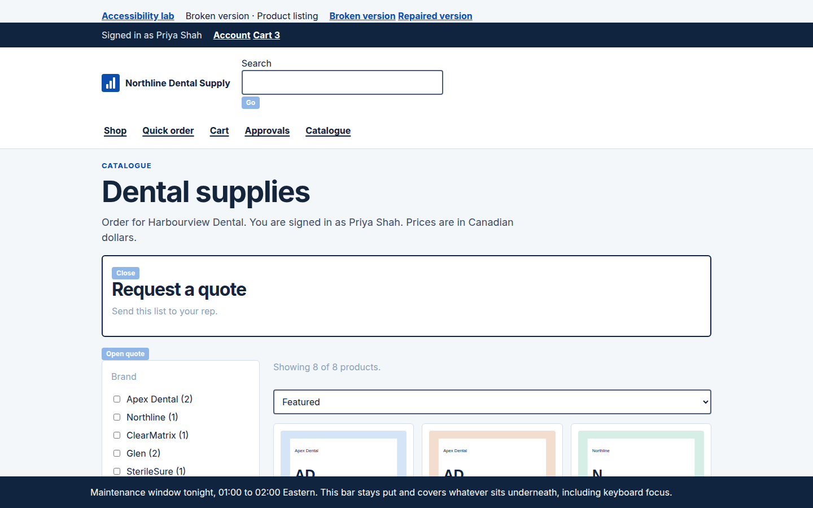
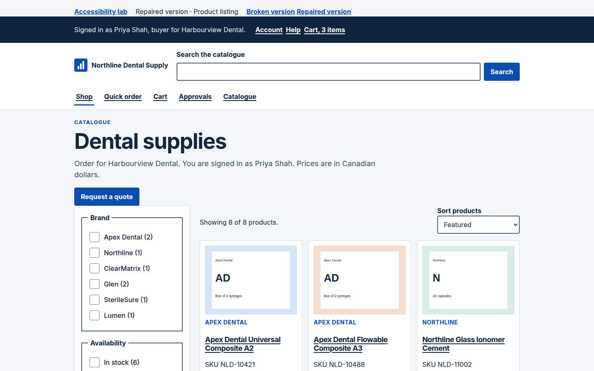
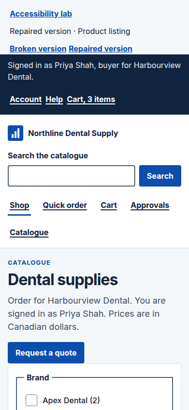
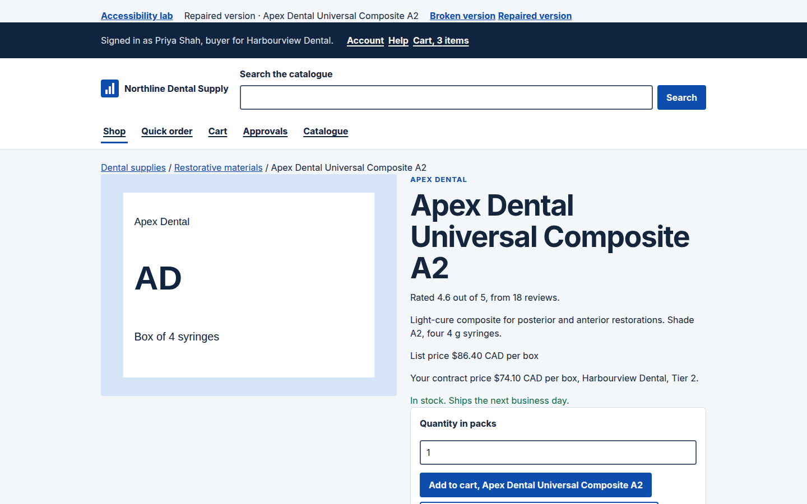
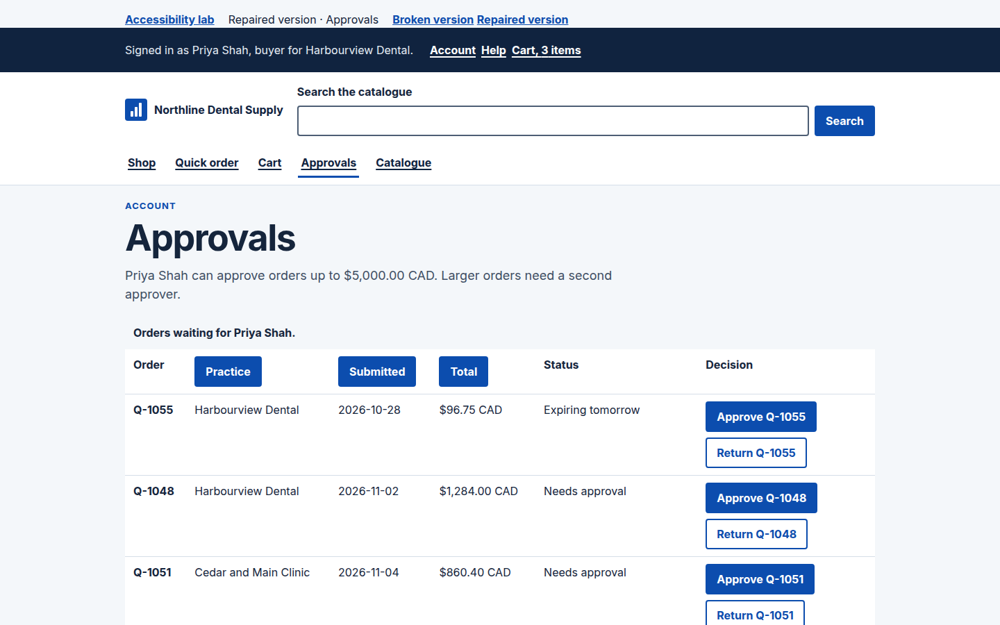

# B2B Commerce Accessibility Best Practices

Northline Dental Supply is a working B2B commerce example for accessibility. The same buying tasks are built twice: a broken storefront a team could ship, and a repaired storefront a buyer can finish with a keyboard, a screen reader, or at 320 pixels wide. The catalogue has 8 products. The buyer on the page is Priya Shah, purchasing for Harbourview Dental.

This is a learning lab, not a live store. Nothing is submitted to a server. It is the same fictional distributor used for search examples elsewhere. It is not a conformance claim, a VPAT, or legal advice.

## What it teaches

- Product listing and faceted filters, including a price control that is not drag-only.
- Product detail pages, spec tables, prices, ratings, and image alternatives.
- Quick order and bulk SKU entry, including errors that name the line and keep the value.
- Cart quantity, reordering, quote requests, and status messages.
- Checkout: labels, redundant entry, zoom, and the absence of a captcha.
- Approval queues, data tables, and charts that are also tables.
- Dialogs, keyboard focus, contrast, target size, and a help link that stays put.
- Catalogue downloads, and why an untagged PDF is not the accessible copy.

## Run locally

Requires Node.js 20 or newer.

```bash
npm install
npx playwright install chromium
npm run check
npm start
```

Open [http://127.0.0.1:4173](http://127.0.0.1:4173). `npm start` reads `PORT` and `HOST`. The default port is 4173.

`npm run check` builds the site, serves it, and runs [axe-core](https://github.com/dequelabs/axe-core) 4.14 through Playwright against the repaired pages and the broken pages. It also runs lab checks for behaviour axe does not score: focus order, a dialog focus trap, error focus, a cart announcement, table headers, and reflow at 320 CSS pixels. The command fails if a repaired page reports a WCAG violation or a broken page stops reporting the ones it is supposed to show.

A repaired run prints `0` violations on every repaired URL. A broken run prints the rule ids, including `label`, `button-name`, `image-alt`, `color-contrast`, `nested-interactive`, `target-size`, `aria-dialog-name`, `frame-title`, and `meta-viewport`.

## Pages to inspect

| Task | Broken | Repaired |
| --- | --- | --- |
| Lab home | | `/` |
| Listing and filters | `/exercises/listing/bad/` | `/exercises/listing/good/` |
| Product detail | `/exercises/product/bad/NLD-10421/` | `/exercises/product/good/NLD-10421/` |
| Quick order | `/exercises/quick-order/bad/` | `/exercises/quick-order/good/` |
| Cart and quote | `/exercises/cart/bad/` | `/exercises/cart/good/` |
| Checkout | `/exercises/checkout/bad/` | `/exercises/checkout/good/` |
| Approvals | `/exercises/approvals/bad/` | `/exercises/approvals/good/` |
| Catalogue | `/exercises/catalogue/bad/` | `/exercises/catalogue/good/` |
| HTML catalogue | | `/exercises/catalogue/read/` |
| Help | | `/help/` |

Every repaired product URL under `/exercises/product/good/` is checked. The broken product check samples `NLD-10421`. The other broken product URLs use the same template.

## Inspect the source

`scripts/build-site.mjs` renders both versions from `src/catalog.json`. Search that file for `variant === "bad"` to see the paired markup. `src/storefront.js` is the behaviour. `src/styles.css` holds the focus ring, the contrast tokens, and the broken-page overrides under `body[data-variant="bad"]`. `scripts/audit.mjs` is the check. `scripts/serve.mjs` serves the static `dist` directory.

On a repaired page, view source and compare the visible label with the control's accessible name. On the broken twin, find the same control with the name missing, the contrast washed out, or the value thrown away after an error.

## Standards and sources

The repaired pages are written against **WCAG 2.2 Level AA**. Level AA means every Level A criterion and every Level AA criterion. WCAG 2.2 is a W3C Recommendation, first published on 5 October 2023 and updated on 12 December 2024.

- [Web Content Accessibility Guidelines (WCAG) 2.2](https://www.w3.org/TR/WCAG22/)
- [Understanding WCAG 2.2](https://www.w3.org/WAI/WCAG22/Understanding/)
- [What's New in WCAG 2.2](https://www.w3.org/WAI/standards-guidelines/wcag/new-in-22/)

Criteria this lab calls out because they show up in a buying flow:

- **2.4.11 Focus Not Obscured (Minimum) (AA).** The broken pages pin a bar over the bottom of the viewport. Keyboard focus lands underneath it.
- **2.5.7 Dragging Movements (AA).** The broken price filter only drags. The repaired filter is two number fields.
- **2.5.8 Target Size (Minimum) (AA).** Broken controls are about 12 to 16 pixels. Repaired controls are at least 24 pixels, and primary actions are 44.
- **3.2.6 Consistent Help (A).** Help is between Account and Cart on every repaired page. The broken header drops it.
- **3.3.7 Redundant Entry (A).** Checkout already knows the account, the practice, and the ship-to. The broken form asks for them again.
- **3.3.8 Accessible Authentication (Minimum) (AA).** The broken checkout asks the buyer to transcribe `7KQM` from an image. The repaired checkout does not.

**4.1.1 Parsing** was removed in WCAG 2.2 and is obsolete. Do not spend a release on it. A VPAT template may still list the row. Mark it obsolete rather than inventing a parser bug.

Older success criteria still do the daily work: text alternatives (1.1.1), information and relationships (1.3.1), contrast (1.4.3), use of colour (1.4.1), resize and reflow (1.4.4, 1.4.10), keyboard (2.1.1), focus visible (2.4.7), link purpose (2.4.4), labels (3.3.2), error identification (3.3.1), name, role, and value (4.1.2), and status messages (4.1.3).

### WAI-ARIA Authoring Practices

[ARIA Authoring Practices Guide](https://www.w3.org/WAI/ARIA/apg/). The [read-me-first](https://www.w3.org/WAI/ARIA/apg/practices/read-me-first/) rule used here is: prefer a native element. The repaired quote dialog is a `<dialog>`. The broken one is a `<div role="dialog">` with `aria-modal="true"`, no accessible name, and no focus trap. `aria-modal` does not trap focus. The [modal dialog pattern](https://www.w3.org/WAI/ARIA/apg/patterns/dialog-modal/) is what the native element already does: name, initial focus, Tab cycle, Escape, and return focus.

Errors move focus to a summary. A cart change uses a [status](https://www.w3.org/WAI/ARIA/apg/patterns/alert/) region so the page does not have to move focus for a successful quantity update. The summary is not also a live region, which would announce the same words twice.

### European Accessibility Act

[Directive (EU) 2019/882](https://eur-lex.europa.eu/eli/dir/2019/882/oj), the European Accessibility Act, applies from **28 June 2025**. Products and services in its scope have to be perceivable, operable, understandable, and robust. E-commerce is in scope when it is a service provided at a distance, through a website or mobile device, at the individual request of a **consumer**, in order to conclude a consumer contract. A closed portal used only by business purchasers is not automatically that definition. A storefront that also sells to an individual practitioner can be. Microenterprises that provide services are exempt. Contracts for services agreed before 28 June 2025 may continue until they end, and not later than 28 June 2030.

The commercial pressure on a B2B team is wider than the strict definition: the same UI is used by employees with disabilities, enterprise buyers paste WCAG AA into the contract, and the technical file European teams are asked for points at EN 301 549.

### EN 301 549

- [EN 301 549 V3.2.1 (2021)](https://www.etsi.org/deliver/etsi_en/301500_301599/301549/03.02.01_60/en_301549v030201p.pdf) is the version cited for a presumption of conformity with the Act until the Commission cites a replacement in the Official Journal. Its web requirements follow WCAG 2.1 Level AA.
- [EN 301 549 V4.1.1 (September 2026)](https://www.etsi.org/deliver/etsi_en/301500_301599/301549/04.01.01_60/en_301549v040101p.pdf) aligns clauses 9, 10, and 11 with WCAG 2.2 Level AA and adds an annex that maps the standard to the Act. It is the direction of travel. It is not yet the legal reference. [AccessibleEU's note on the update](https://accessible-eu-centre.ec.europa.eu/content-corner/news/european-accessibility-standard-en-301-549-has-been-updated-2026-09-07_en) says the same thing.

Clause 10 is why the catalogue exercise exists. A PDF downloaded from the storefront is a document, not a web page. axe does not open it. The sample PDF in this lab is untagged and has no document language. The repaired path is the HTML catalogue. Offer the PDF only with a link that says it is not the accessible copy, until a tagged file has been tested.

### ADA and Section 508

**ADA Title III** (42 USC §§ 12181–12189) covers public accommodations. The statute does not name WCAG. The [Department of Justice's web guidance](https://www.ada.gov/resources/web-guidance/) treats websites of public accommodations as covered. There is still no DOJ technical standard in a final rule for private Title III sites. Settlements and court orders commonly require WCAG 2.1 AA or 2.2 AA.

The [April 24, 2024 Title II rule](https://www.federalregister.gov/documents/2024/04/24/2024-07758/nondiscrimination-on-the-basis-of-disability-accessibility-of-web-information-and-services-of-state) sets **WCAG 2.1 AA** for state and local government web content, with compliance dates in 2026 and 2027 depending on the entity. That rule is not a private-commerce rule. It is the specification public-sector buyers will recognise.

**Section 508** of the Rehabilitation Act (29 USC § 794d) applies to US federal ICT. The [Revised 508 Standards](https://www.access-board.gov/ict/) incorporate **WCAG 2.0 Level AA** by reference. [Section508.gov](https://www.section508.gov/) is the agency-facing home for that. Federal buyers ask for an Accessibility Conformance Report. Building to WCAG 2.2 AA covers the 2.0 AA baseline those templates still name, aside from the removed 4.1.1 row.

A B2B portal meets this in three ordinary ways: a customer's employees have to use it, a customer flows a WCAG clause into the supplier contract, or a government buyer asks for 508 language in the RFP.

### India, briefly

The [Rights of Persons with Disabilities Act, 2016](https://www.indiacode.nic.in/handle/123456789/15939) is the statute. Rule 15 of the RPwD Rules, amended by **G.S.R. 359(E) on 10 May 2023**, requires ICT in scope to conform to **IS 17802 (Part 1): 2021** and **IS 17802 (Part 2): 2022**. Those Indian standards follow the EN 301 549 model, which at that date tracks WCAG 2.1 AA rather than 2.2. The same amendment says documents placed on websites should be EPUB or OCR-based PDF. A scanned catalogue fails that on its face.

[GIGW 3.0](https://guidelines.india.gov.in/), the Guidelines for Indian Government Websites and apps, is written for government sites and is aligned to WCAG 2.1 AA. Rule 15 names it as the website standard. A private dental catalogue is not a government website. Indian public-sector buyers still write GIGW, IS 17802, or WCAG AA into tenders. That is the product reason to know the names.

## Why each task matters

**Listing and filters.** Who: a buyer who tabs, a buyer who zooms, a buyer who cannot see which checkbox is which. Business: faceted search is the finding path for a repeat order. If the price control only drags, or the result count updates in silence, the order does not get built. Acceptance: every filter is a labelled control, price can be typed, the new count is announced, Add to cart names the product and does not contain another link, focus is visible and not covered.

**Product detail and the spec table.** Who: a buyer confirming shade, cure time, and pack before a clinical purchase. Business: the spec is the difference between a correct reorder and a return. A photo with `alt=""` is marked decorative, so a screen reader skips the pack shot and axe stays quiet about that image. The star graphic omits `alt` and is the violation you can see in the report. Acceptance: the photo alt names the product and the pack, the rating is text, list price and contract price are both named, and the spec table has a caption and row headers.

**Quick order.** Who: a purchaser keying SKUs from a shelf or a paste out of a spreadsheet. Business: this is the fastest path for a 40-line reorder, and it is where a vague error costs a cart. The broken form says "something went wrong" and clears the SKUs. Acceptance: each line has a unique name, the paste box explains the pattern, errors name the line and the code, focus moves to the summary, and the typed value stays.

**Cart and quote.** Who: the same buyer, now changing quantities and asking a rep to hold a price. Business: a silent quantity change and a drag-only reorder stop an order that was otherwise done. Acceptance: the cart is a table, quantity buttons name the product, the new quantity is announced, lines move with buttons, and the quote form has visible labels.

**Checkout.** Who: Priya, who already has an account number and a ship-to on file, and anyone who needs to zoom the form. Business: retyping known data and transcribing a captcha are abandoned checkouts, and locking zoom fails 1.4.4 on purpose (`user-scalable=no`). Acceptance: account data on file is text, errors are specific, values remain, zoom works, and there is no cognitive test.

**Approvals.** Who: a buyer or a finance approver moving through a queue, often by buttons rather than by reading the table left to right. Business: four buttons that all say "Approve" are how the wrong order gets released. A spend chart that is only an image hides the quarter from anyone who cannot see it. Acceptance: Approve and Return include the order id, status is text, the queue sorts from the keyboard, and the percentages exist in a table.

**Catalogue and PDF.** Who: a practice that keeps the yearly catalogue, and a buyer using a screen reader on the download link. Business: "click here" plus an untitled frame is how a legal document requirement gets missed. Acceptance: the accessible copy is the HTML catalogue, the PDF link names the format and says it is not the accessible copy, and there is no untitled iframe.

## PM acceptance checklist

Use these as story acceptance criteria. A story is not done when the happy path works with a mouse on a desktop.

- The page sets `lang`. The repaired pages use `en-CA`.
- The first keyboard stop is "Skip to content".
- Help is in the same header position on every page in the flow: Account, Help, Cart.
- Every control has a visible label. Placeholder text is not the label.
- The accessible name includes the visible words, in the same order. "Add to cart, Apex Dental Universal Composite A2" contains "Add to cart".
- Buttons that repeat a verb also carry the product or the order id.
- Images that convey the product have an alt that names the product and the pack. Decorative images that repeat a heading use `alt=""`.
- Text contrast is at least 4.5:1. Interface boundaries and focus are at least 3:1. Status is not colour alone.
- Targets are at least 24 by 24 CSS pixels. Primary actions are 44 by 44.
- Any dragging action has a typed or button alternative.
- Focus is visible. A sticky region does not cover the focused control. Nothing traps the keyboard except a dialog, which releases focus on Escape.
- Filters and sorts work from the keyboard, and the result count is announced when it changes.
- Specs, the cart, the approval queue, and the catalogue are tables with header cells.
- Errors name the field, are linked from a summary, move focus to that summary, and do not clear what the buyer typed.
- Information the account already holds is not asked for again.
- Checkout does not use a captcha or any other cognitive test.
- The page reflows at 320 CSS pixels without a horizontal scrollbar on the page. A wide table scrolls inside a named region that can take focus.
- Pinch zoom is allowed. The viewport does not set `user-scalable=no` or `maximum-scale=1`.
- A download link names the file type, the size when you know it, and whether that file is the accessible copy.
- `npm run check` is clean on the repaired pages before the story is accepted.

## Manual testing checklist

The automated check does not replace this. Run it on the repaired page, then on the broken twin, and write down what changed. This environment cannot run VoiceOver. The steps below are for a Mac.

### Keyboard, any browser

1. Click the address bar, then press Tab. On a repaired page the first stop is "Skip to content". Activate it. The next stops are in the storefront, not the lab chrome you already passed.
2. Tab through filters, sort, Add to cart, and the quote button. The focus ring is a blue outline. On the broken listing the ring disappears once focus enters the storefront, and the price handle never takes focus.
3. Shift+Tab moves backward. You can reach every control, and you can leave the page.
4. Space toggles a checkbox. Enter submits a form. Enter or Space activates a button.
5. On the repaired listing, activate "Request a quote". Tab cycles inside the dialog. Escape closes it and returns focus to "Request a quote". On the broken listing the quote panel is already open, it has no name, and Tab walks out of it.
6. On the broken pages, tab until focus reaches "Back to top of this example". The maintenance bar covers it. The repaired pages have no such bar.
7. Set the window to 320 pixels wide, or zoom the browser to 400%. The repaired page scrolls vertically. A wide table scrolls inside its region. The broken page scrolls sideways because the storefront is a fixed desktop width.
8. On quick order, enter `NLD-NOPE` and quantity `2`, then submit. The repaired page moves focus to "Fix the lines below" and leaves `NLD-NOPE` in the field. The broken page clears the field and says "Something went wrong with your order."
9. On the cart, increase the composite. The repaired page writes the new quantity into the status line, including the product name. The broken page changes a digit and says nothing.
10. On approvals, activate "Total" twice. The repaired table sorts and announces the sort. Activate "Approve Q-1048" and confirm the status names that order.

### VoiceOver on macOS

Turn VoiceOver on with Command-F5. The VoiceOver modifier (VO) is Control-Option. Use VO-Right Arrow and VO-Left Arrow to move, VO-Space to activate, and Tab when you want the same path as the keyboard test. VO-U opens the rotor. From the rotor, walk Headings, Links, Form controls, Tables, and Landmarks.

On the repaired listing you should hear:

- The page language is English. The broken pages do not set a language, so pronunciation can be wrong for the whole document.
- "Skip to content", then the account navigation, including Help.
- "Search the catalogue", as a labelled search field.
- Landmarks: main, navigation, search. The broken header is not marked up as navigation.
- Each filter by its name ("Apex Dental (2), checkbox"). The broken checkboxes are announced without a name. The words sit beside them and are not connected.
- After you check a brand, "Showing N of 8 products."
- The product as a heading and a link, the rating as a sentence, and "Add to cart, Apex Dental Universal Composite A2, button". The broken Add control is nested with "Details" and the star image has no alternative.
- "Request a quote, dialog" when the dialog opens, and the note field by its label.

On the repaired product page, rotor to Tables. VoiceOver should announce the caption "Specifications for…" and each row header ("Shade, A2"). The broken spec table has no headers, so the cells are an unlabelled stream. The broken product photo has an empty alt, which means VoiceOver skips it. That silence is the bug. axe does not report it.

On the repaired approval table, navigate by row and by column header. Then use the rotor's Form controls list. "Approve Q-1048" and "Approve Q-1055" are different. On the broken page the rotor lists "Approve" four times, and Return has no name.

On a cart change, VoiceOver should speak the status without you moving focus: "Quantity of Apex Dental Universal Composite A2 is 3."

If you also have Windows, NVDA's browse mode is the parallel check: Down Arrow to read, H for the next heading, Tab into forms, and Insert-Down Arrow to read continuously. The things you listen for are the same.

## What the scanner misses on purpose

axe-core is the right regression check and a poor definition of done.

- An image with `alt=""` passes `image-alt`. That is correct when the image is decorative. It is a false pass when the image is the product. The broken product photo is the demonstration. The star image omits the attribute, so `image-alt` fires, and the lab check calls out the empty alt separately.
- axe's `label` rule treats a non-empty **placeholder** as a label. These broken fields do not use placeholders. They put the word "SKU" or "PO number" in a `<span>` next to the input. That fails `label`, which is the bug teams actually ship. A placeholder-only field can stay silent in this version of axe. Do not use that silence as acceptance.
- A button that contains a link fails `nested-interactive`. A link that contains a button did not, in axe 4.14, because of how the rule is scoped. The broken cards use the pattern the rule catches. Still reject both patterns in review.
- `aria-dialog-name` is tagged best-practice in axe 4.14, not WCAG, even though a dialog without a name fails 4.1.2. The check runs that rule in addition to the WCAG tags.
- Missing table headers, drag-only controls, identical "Approve" buttons, "click here", and a cleared form are asserted by the lab checks or left for the manual list. A div that looks like a table is invisible to the table rules.
- Focus obscured (2.4.11) is measured by the lab check on the listing, not by axe.
- The PDF is not parsed. Test a real catalogue with a document checker and with a screen reader, or publish the HTML.
- A live region can exist and still be a bad announcement. Listen to it.

## Screenshots













## Deploy

`npm run build` writes a static `dist` directory. `vercel.json` is included so that directory can be deployed later. This project does not publish itself, and it should stay private until you choose otherwise.
